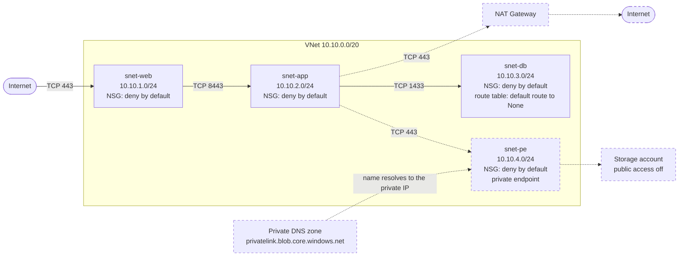
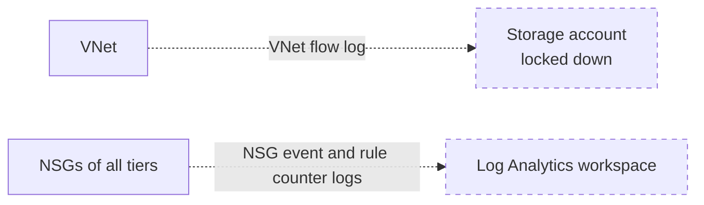

# Azure Networking Foundation

A reference implementation of a segmented Azure network, built with Terraform in small, documented steps. **Work in progress.** Each piece is deployed, verified, documented and then destroyed to keep costs low. In the status table, **Deployed** means deployed and checked during a session, then destroyed afterwards, so nothing is running now.

## Architecture

Dashed boxes and lines are optional parts, each behind a `deploy_*` switch (see "Run it yourself"). The arrows show the application flows the NSGs allow, and everything else is denied. Every rule is in the [traffic matrix](docs/traffic-matrix.md).

Monitoring (`deploy_monitoring`) is collected by the Azure platform, not by an agent inside a VM:

## Status

| Area | State |
|---|---|
| Resource group, virtual network, tags, naming convention | Done |
| Web subnet (no default outbound access) and web NSG with deny-by-default inbound | Done |
| CI: format check, init, validate, tflint with the Azure ruleset and a pinned Checkov security scan (blocking, including the optional code behind the switches) on every push and pull request, with documented failing tests ([Checkov](docs/evidence/ci-negative-test.md), [tflint](docs/evidence/tflint-negative-test.md), [Checkov on switch-gated code](docs/evidence/checkov-switch-gated-negative-test.md)) | Done |
| App and database subnets with NSGs, tested with live traffic on three small VMs ([evidence](docs/evidence/live-traffic-test.md)) | Done |
| Routing and outbound design: optional NAT Gateway on the app tier and a route table on the database subnet, tested with live traffic ([evidence](docs/evidence/outbound-nat-test.md)) | Done |
| Private endpoint and private DNS: a storage account on a private IP with a linked private DNS zone, tested with live traffic ([evidence](docs/evidence/private-endpoint-test.md)) | Done |
| Monitoring: a VNet flow log in a locked down storage account and NSG logs in a Log Analytics workspace, tested with live traffic ([evidence](docs/evidence/monitoring-test.md)) | Done |
| Branch protection on `main` (pull request and passing checks required) | Done |
| Remote state in Azure Storage with Entra ID auth and versioning ([details](docs/remote-state.md)) | Done |
| Terraform plan on every pull request with OIDC login (no stored secret, read-only roles) ([evidence](docs/evidence/oidc-plan-test.md)) | Done |
| Terraform module for the three tiers (`infra/modules/tier`: one definition of subnet, NSG and rules, used for web, app and db), checked to give an identical plan | Done |
| Hub-and-spoke: a hub and two spokes (one in another region) joined by VNet peering, with a live test of the allowed paths and of the missing spoke to spoke path ([evidence](docs/evidence/hub-spoke-test.md)) | Done |
| Modules for the optional parts | Planned |

## Documentation

- [IP address plan](docs/ip-address-plan.md): subnet ranges and the reasoning behind them
- [NSG rules](docs/nsg-rules.md): every rule, its priority and why it exists, based on the [traffic matrix](docs/traffic-matrix.md)
- [Evidence](docs/evidence/): command output captured before each teardown
- [Remote state](docs/remote-state.md): why state lives in Azure Storage, the bootstrap script, settings, cost and limits
- [Troubleshooting](docs/troubleshooting.md): problems met while building this, what was seen and what fixed them

## Design principles

- Deny by default, with each exception documented
- No credentials or subscription IDs in code: authentication uses the Azure CLI login
- Pinned Terraform and provider versions, with the lock file committed
- Names follow the Microsoft Cloud Adoption Framework pattern: type, workload, environment, region, instance
- Plan before apply, destroy after every session. Changes to `main` go through pull requests with required CI checks (format, validate, tflint, Checkov)

## Run it yourself

Requires Terraform, the Azure CLI and an Azure subscription. The network resources are free. The optional test VMs (`deploy_test_vms = true`, see the [live traffic test](docs/evidence/live-traffic-test.md)), the optional NAT Gateway (`deploy_nat_gateway = true`, see the [outbound test](docs/evidence/outbound-nat-test.md)) and the optional private endpoint (`deploy_private_endpoint = true`, see the [private endpoint test](docs/evidence/private-endpoint-test.md)) are billed per hour, so destroy them the same day. The optional monitoring (`deploy_monitoring = true`, see the [monitoring test](docs/evidence/monitoring-test.md)) is billed by the amount of data it collects, so destroy it the same day too. This repository does not quote prices: they depend on the region, the size and your subscription, so read your own figures in Azure Cost analysis. State is stored remotely: `infra/backend.tf` points at a storage account that belongs to the repo owner, so to run this yourself first create your own with `bootstrap/create-state-storage.sh` (change the names in it) and pass your names to `terraform init` with `-backend-config`. See [remote state](docs/remote-state.md).

    az login
    export ARM_SUBSCRIPTION_ID=$(az account show --query id -o tsv)
    cd infra
    terraform init
    terraform plan
    terraform apply
    terraform destroy

## Known simplifications

- Terraform state is remote (Azure Storage, Entra ID auth, versioned), but in a locally redundant, single-region account with a public endpoint protected by authentication only. It lives in a free-trial subscription. See [remote state](docs/remote-state.md).
- The NSG rules, the outbound design, the private endpoint and the monitoring were each tested with live traffic in one full run (TCP only). See the evidence for what the tests do and do not prove: [NSG rules](docs/evidence/live-traffic-test.md), [outbound design](docs/evidence/outbound-nat-test.md), [private endpoint](docs/evidence/private-endpoint-test.md) and [monitoring](docs/evidence/monitoring-test.md).
- A single flat VNet is a starting point, not an enterprise landing zone.
- The web tier accepts HTTPS from the whole internet. A production design would put Application Gateway, Front Door or a firewall in front.
- Ports 8443 (web to app) and 1433 (app to database) are placeholders for a reference implementation.
- By default there is no outbound path to the internet. An optional NAT Gateway on the app tier (`deploy_nat_gateway = true`) allows outbound TCP 443 only. It filters by port, not by domain, so any host on 443 is reachable. See the [evidence](docs/evidence/outbound-nat-test.md).
- The private endpoint is tested with an empty storage account that has public access and shared keys turned off. Terraform cannot reach the data plane of such an account, so `infra/providers.tf` sets `data_plane_available = false` for every storage account in this configuration, and they are managed through the management API only. Three Checkov findings on the test account are skipped in the code, each with a written reason.
- The private endpoint test checked DNS from the app VM only, and only TCP 443, in one full run. It did not test a real workload or any data access. See the [evidence](docs/evidence/private-endpoint-test.md).
- Monitoring uses a VNet flow log written to a storage account and NSG logs sent to a Log Analytics workspace. Traffic Analytics is not used, because it is billed per GB. The flow log storage account keeps public network access enabled behind a firewall that denies by default and allows trusted Azure services, which is the design that was tested. Disabling public network access completely was not tested. Reading the blobs from a laptop needs an optional IP rule (`TF_VAR_flow_log_reader_ip`), which is never committed. Five Checkov findings on that account are skipped in the code, each with a written reason. See the [evidence](docs/evidence/monitoring-test.md).
- Only the three tiers are a module (`infra/modules/tier`). The optional parts (NAT Gateway, private endpoint, monitoring, test VMs) are still flat files in `infra/`. The plan counts matched before and after the refactor for nine switch combinations, and the plan with every switch on was compared setting by setting and was identical. CI runs `tflint` on `infra` only, so it does not lint the module (a local `tflint --recursive` is clean).
- The plan on pull requests uses a read-only identity (Reader on the subscription and Storage Blob Data Reader on the state container) and runs with `-lock=false`. It plans the default configuration only, not the code behind the optional switches. The logs are public, so the IDs are repository secrets. Fork and Dependabot pull requests skip the job. A negative test showed the identity cannot write to the state container or create a resource group. See the [evidence](docs/evidence/oidc-plan-test.md).
- Hub and spoke is optional (`deploy_hub_spoke = true`) and has no firewall: the hub holds one shared subnet only, and traffic between spokes is blocked by the missing route and the NSGs, not inspected. Spoke 2 is in japaneast because of a 4 vCPU regional quota. Tested with TCP only, in one full run. See the [evidence](docs/evidence/hub-spoke-test.md).
